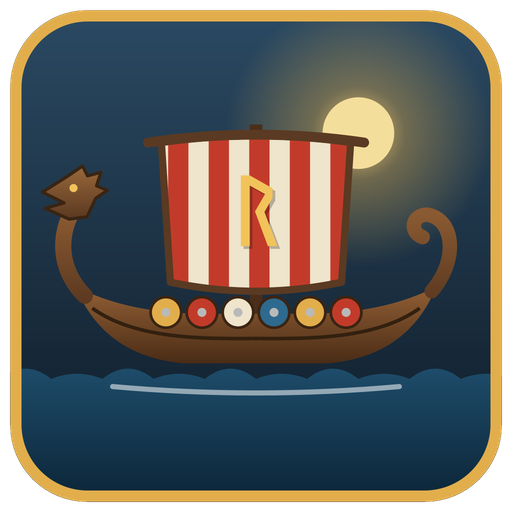
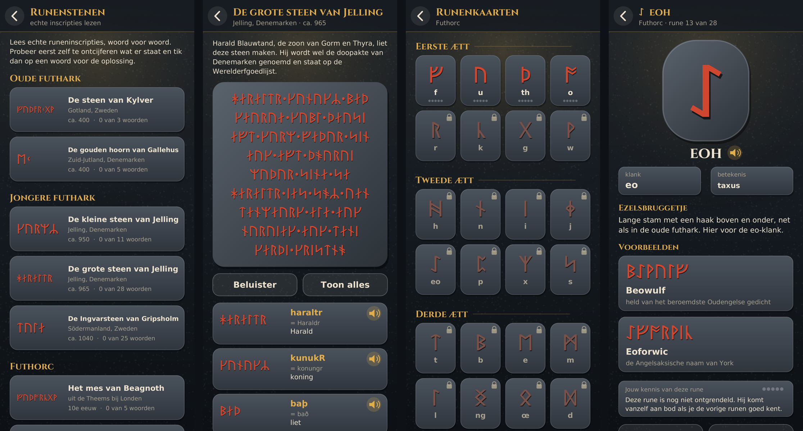

<p align="center"></p>

# Runen

Een Android-app om runenschrift te leren: de **oude futhark**, de **jongere futhark** van de vikingen en de **futhorc** van de Friezen en Angelsaksen. Je oefent in korte rondes, leest echte runenstenen woord voor woord, en zet je eigen naam om in runen. De app houdt je voortgang bij.



## Wat zit erin

- **Drie runenrijen**
  - Oude futhark: 24 runen, ca. 150–750.
  - Jongere futhark: 16 runen, de vikingtijd.
  - Futhorc: 28 runen, Friezen en Angelsaksen.
- **Runenkaarten.** Per rune zie je de naam, de klank, de betekenis en een ezelsbruggetje, met voorbeeldnamen van personen en plaatsen in runen, zoals Harald, Dorestad, Beowulf en Dokkum. Bij de vikingrunen staan ook woorden precies zoals ze op een historische steen staan.
- **Oefenen** in rondes van 10 vragen. Er zijn vier soorten vragen:
  - rune → klank
  - klank → rune
  - een naam lezen
  - een naam schrijven met een runentoetsenbord

  Nieuwe runen komen vier tegelijk vrij zodra je de vorige goed kent. Elke nieuwe rune wordt eerst uitgelegd.
- **Voortgang.** Elke rune zit in een van vijf vakjes (een Leitner-systeem): zwakke runen komen vaker terug. De app houdt ook punten, het aantal dagen op rij, rondes en het percentage goede antwoorden bij.
- **Runenstenen lezen.** Zeven echte inscripties, die je woord voor woord ontcijfert, met de genormaliseerde vorm, een Nederlandse vertaling en uitspraak:
  - Kylver
  - Gallehus
  - de kleine en de grote steen van Jelling
  - de Ingvarsteen van Gripsholm
  - het mes van Beagnoth
  - het Franks Casket
- **Schrijf je naam.** Typ een tekst en zie hem in runen, rune voor rune uitgelegd. Bij de jongere futhark kun je **gestippelde runen** aanzetten (ᛂ ᚵ ᛑ ᛔ ᚤ): die zijn vanaf ongeveer het jaar 1000 in gebruik.
- **Uitspraak** van alle runennamen en inscripties, als gereconstrueerd Oergermaans, Oudnoors of Oudengels.
- **Over runen.** Achtergrond en geschiedenis, met runenvondsten in Nederland.

De app is in het Nederlands, werkt in portretstand en schaalt mee met telefoons en tablets.

## Bouwen

De app wordt zonder Gradle gebouwd, met de losse Android-hulpmiddelen. Op Debian of Ubuntu installeer je die zo:

```sh
sudo apt install android-sdk-platform-23 aapt dalvik-exchange zipalign apksigner default-jdk
```

Daarna:

```sh
./build.sh
```

Dat maakt `Runen.apk`. Het script doet achter elkaar:

1. `aapt` voor `R.java`
2. `javac` (Java 8)
3. `dalvik-exchange` (dx)
4. `aapt` om de APK in te pakken (met ongecomprimeerde fonts en geluid)
5. `zipalign`
6. `apksigner`

De app werkt vanaf Android 5.0 (minSdk 21, targetSdk 34).

### Ondertekenen

`build.sh` ondertekent de APK met `debug.keystore` (alias `runen`, wachtwoord `android`). Bestaat dat bestand niet, dan maakt het script een nieuwe sleutel aan.

**Let op:** alleen met dezelfde sleutel kun je een nieuwe versie over een geïnstalleerde app heen zetten. Bewaar `debug.keystore` daarom op een veilige plek, maar zet hem niet in een openbare repository. Iedereen met de sleutel kan dan een app maken die zich als update van de jouwe voordoet. `.gitignore` sluit hem daarom uit.

## Projectindeling

```
src/nl/rarevogel/runen/
  MainActivity.java      Android: activity, tekenview, opslag, geluid, trillen
  AndroidGfx.java        tekenlaag op een Android Canvas
  core/                  alles zonder Android-afhankelijkheden
    App.java             alle schermen, layout en aanraking
    Runes.java           de drie runenrijen met namen, klanken, betekenis, ezelsbrug, voorbeelden, uitspraak
    Stones.java          de inscripties, woord voor woord
    Translit.java        omzetten van letters naar runen
    Quiz.java            samenstellen van een oefenronde
    Progress.java        voortgang (Leitner-vakjes, punten, reeks, gelezen woorden)
    Gfx.java             kleine teken-interface, gedeeld door Android en de desktoptests
assets/
  runic.ttf              Noto Sans Runic
  cinzel-bold.ttf        Cinzel (statische vette versie)
  audio/                 uitspraak (.ogg), gemaakt met tools/make_audio.py
res/drawable/icon.png    app-icoon
test/                    desktop-hulpprogramma's (zie hieronder)
tools/make_audio.py      maakt de uitspraakbestanden
```

Alles in `core/` is gewone Java. Daardoor kun je de hele app op de desktop draaien en testen via een Java2D-versie van `Gfx`.

## Testen op de desktop

```sh
mkdir -p /tmp/rt
javac -encoding UTF-8 -d /tmp/rt src/nl/rarevogel/runen/core/*.java test/nl/rarevogel/runen/core/*.java

# Controleert alle voorbeelden en inscripties, en speelt de oefenrondes van alle drie de rijen uit
java -cp /tmp/rt nl.rarevogel.runen.core.DataTest

# Schermafbeelding van een scherm, bijvoorbeeld de grote steen van Jelling met 6 woorden gelezen
java -Djava.awt.headless=true -cp /tmp/rt nl.rarevogel.runen.core.Shot jelling.png 1080 2400 stone:jelling2:6

# Willekeurig tikken, vegen en terugknoppen langs alle schermen, om crashes te vinden
java -Djava.awt.headless=true -cp /tmp/rt nl.rarevogel.runen.core.Monkey 5000

# Het app-icoon opnieuw tekenen
java -Djava.awt.headless=true -cp /tmp/rt nl.rarevogel.runen.core.Icon icoon.png
```

Andere scènes voor `Shot` zijn onder meer:
- `home`, `cards`, `detail:<nr>`, `quiz:<type>`, `summary`, `write:<tekst>`, `progress`, `info` en `stones`.
- Zet `J` (jongere futhark) of `A` (futhorc) achter de scènenaam om de runenrij te kiezen, bijvoorbeeld `cardsA`.

## Uitspraak opnieuw maken

De uitspraak staat als fonemen bij elke rune (in `Runes.java`) en bij elk woord van een inscriptie (in `Stones.java`). Daarvan maakt eSpeak NG de geluiden, met de Icelandic-klanktabel; de `r` wordt automatisch een rollende r. Er is ffmpeg met libvorbis nodig.

```sh
java -cp /tmp/rt nl.rarevogel.runen.core.DumpPron | python3 tools/make_audio.py
```

De uitspraak is een reconstructie: niemand weet precies hoe deze talen klonken.

Wil je echte opnames gebruiken? Zet dan `.ogg`-bestanden met dezelfde namen in `assets/audio/`:
- `n_<rij><nummer>.ogg` voor runennamen, bijvoorbeeld `n_O0.ogg` voor fehu;
- `s_<steen>.ogg` voor een hele inscriptie;
- `s_<steen>_<woord>.ogg` voor één woord.

## Omzetten naar runen

Voor de voorbeeldnamen en "Schrijf je naam" gelden vaste regels. Dit is een moderne afspraak, geen historische spelling:

- Eerst worden letterparen omgezet:
  - th → ᚦ
  - ng → ᛜ (futhorc: ᛝ)
  - ie → ᛁ
  - oe → ᚢ
  - ei en ij → ᛇ (jongere futhark: ᛅᛁ)
  - alleen in de futhorc: ea → ᛠ, eo → ᛇ, ae → ᚫ, eu → ᛟ
- Daarna de losse letters. c, ch, k en q worden de k-rune; een c vóór e, i of y wordt een s. Een v wordt ᚠ.
- Dubbele runen worden één rune, zoals de runenmakers ook deden.
- In de jongere futhark staat één rune voor meerdere klanken: ᛁ is i, e of j; ᚢ is u, o, v of w; ᛏ is t of d.

## Bronnen

De inscripties volgen de Scandinavische runendatabase (Rundata) en de gangbare lezingen van de Engelse voorwerpen:

- [Rundata: DR 42, de grote steen van Jelling](https://rundata.info/inscription/dr-42/)
- [Runes DB: Stein 2 von Jelling](https://runesdb.de/find/1159)
- [Rundata: DR 12, de hoorn van Gallehus](https://rundata.info/inscription/dr-12/)
- [World Tree Project: Sö 179, de steen van Gripsholm](https://www.worldtreeproject.org/document/1511)
- [Wikipedia: Jelling stones](https://en.wikipedia.org/wiki/Jelling_stones)
- [Wikipedia: Seax of Beagnoth](https://en.wikipedia.org/wiki/Seax_of_Beagnoth)
- [Wikipedia: List of rune-row inscriptions](https://en.wikipedia.org/wiki/List_of_rune-row_inscriptions)

De namen van de runen in de oude futhark zijn reconstructies.

## Licenties

- **Lettertypes:** [Noto Sans Runic](https://github.com/notofonts/runic) en [Cinzel](https://github.com/NDISCOVER/Cinzel), beide onder de SIL Open Font License 1.1. De licentieteksten staan in `assets/OFL-NotoSansRunic.txt` en `assets/OFL-Cinzel.txt`.
- **Code:** nog geen licentie gekozen.
